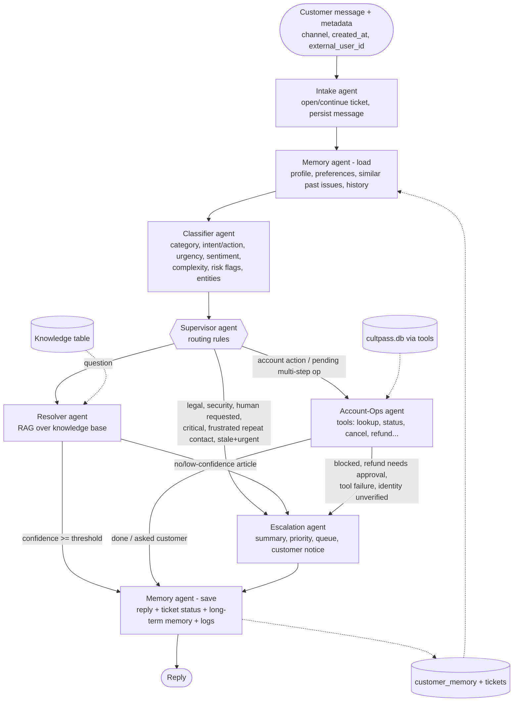

# UDA-Hub – Multi-Agent Architecture Design

Pattern: **Supervisor** (hub-and-spoke). A Supervisor agent inspects the classified ticket and delegates to one
specialist; specialists either finish or hand the ticket to the Escalation agent. Implemented with a hand-built
LangGraph `StateGraph` (no prebuilt agents / sample workflow).

## 1. Diagram



ASCII view:

```
 msg -> intake -> memory(load) -> classifier -> supervisor --> resolver ----(ok)-----> memory(save) -> reply
                                                    |   \                 \--(low)--> escalation --^
                                                    |    +-> account_ops -(ok)----------------------^
                                                    |                    \-(fail/approval)-> escalation
                                                    +--(risk, human, critical, repeat+angry, stale)--> escalation
```

## 2. Agents and responsibilities

| Agent (file) | Role | Reads | Writes |
|---|---|---|---|
| Intake (`agents/intake.py`) | Creates the ticket on the first turn of a thread, stores each user message, resets per-turn fields | message, `external_user_id`, `created_at` | `tickets`, `ticket_metadata`, `ticket_messages` |
| Memory (`agents/memory_agent.py`) | **load**: customer profile, preferences, similar resolved issues, prior-ticket counts. **save**: assistant reply, ticket status/metadata, preferences, resolved-issue summary | `customer_memory`, `tickets` | same tables |
| Classifier (`agents/classifier.py`) | Structured classification of the ticket (LLM structured output, rule-based fallback; rules can only switch risk flags *on*) | text, channel, ticket age, history | `classification` |
| Supervisor (`agents/supervisor.py`) | Pure routing policy; records the reason for every decision | classification, memory, `pending_action` | `route`, `route_reason` |
| Resolver (`agents/resolver.py`) | Answers **only** from KB articles; computes confidence; escalates if none relevant | KB via `search_knowledge_base` tool | `draft_response`, `resolution` |
| Account-Ops (`agents/account_ops.py`) | Performs account operations through tools with a confirm-before-change state machine | CultPass DB via tools | tool results, `pending_action` |
| Escalation (`agents/escalation.py`) | Builds hand-off note, priority (P1–P3), queue; tells customer what happens next | everything above | `escalation`, system `ticket_message` |

Why Account-Ops is a deterministic state machine rather than a free tool-calling LLM loop: it can cancel subscriptions and move money, so every
step (identify → choose → confirm → execute) must be auditable and testable. The LLM is used where free text understanding matters
(classification, answer generation, hand-off note).

## 3. Flow of information and decisions

Shared state (`agentic/state.py`) is passed node to node. Key fields: `messages`, `classification`, `memory_context`, `route`,
`kb_results`, `resolution {status: resolved|awaiting_customer|escalate, confidence, reason}`, `pending_action`, `tool_usage`,
`decision_log`. Each agent appends to `decision_log` and to the JSONL log.

**Routing policy** (first match wins, `supervisor.decide_route`):
1. open `pending_action` → Account-Ops (continue multi-step operation)
2. security risk / legal threat / customer asks for a human / critical urgency → Escalation
3. negative or angry sentiment **and** an unresolved escalation in the last 30 days → Escalation
4. high urgency and ticket older than 48 h → Escalation (metadata: `created_at`)
5. intent = account action → Account-Ops
6. otherwise → Resolver

**Post-specialist routing:** `resolution.status == "escalate"` → Escalation, else → Memory(save).

## 4. Input types and expected outputs

| Input | Handling | Output |
|---|---|---|
| "How do I reset my password?" | question → Resolver → KB article kb-009 | answer text, status `resolved` |
| "Please cancel my subscription" (anonymous) | action → Account-Ops asks for email → asks YES/NO → `cancel_subscription` | confirmation, `resolved` |
| "I want a refund" (premium annual, $299.99) | Account-Ops → eligibility says approval needed → pending refund record | `escalate` → billing_team P2 |
| "What's the weather?" | Resolver finds no article / below threshold | `escalate` → general_support |
| "Someone hacked my account" | security flag | `escalate` → trust_and_safety P1 |
| "hi" / "help" | smalltalk / unclear | greeting or clarification, `awaiting_customer` |

## 5. Knowledge retrieval (RAG) and confidence

`agentic/tools/kb_search.py`: normalise (lowercase, stop-words, light stemming, small synonym map) → TF-IDF with uni+bi-grams over
`title×3 + tags×2 + content` → cosine similarity. `confidence = similarity × (0.5 + 0.5 × coverage)` where *coverage* is the share of the
query's terms found in the article. Threshold `UDAHUB_CONFIDENCE_THRESHOLD` (default 0.17, tuned on the test queries: relevant ≥ 0.19, off-topic ≤ 0.16).
With an LLM, the Resolver additionally requires `can_answer=true` and `confidence ≥ 0.5` from the model, which is told to use only the retrieved articles.
Without an LLM the answer is extractive (best-matching sentences of the top article), so every response is grounded in KB text.

## 6. Memory

| Type | Mechanism | Scope |
|---|---|---|
| State within one execution | LangGraph state | one graph run |
| Short-term / session | SQLite checkpointer keyed by `thread_id` (`workflow.get_checkpointer`); `inspect_thread()` shows messages, tool usage, decisions | one conversation |
| Long-term | `customer_memory` table: `resolved_issue` summaries (recalled by TF-IDF similarity) and `preference` rows (response style, contact channel, preferred name) | per customer, across sessions |
| Conversation history | `tickets` + `ticket_messages` | persistent, queryable with `memory.customer_history` |

Memory changes behaviour: greeting by name, concise/detailed answers, "you asked something similar on <date>" note, escalation counts feeding the
Supervisor's repeat-contact rule, contact-channel preference in the escalation notice.

## 7. Tools (database abstraction)

`agentic/tools/cultpass_db.py` is the only code that touches the CultPass DB. Functions validate input, catch DB errors and always return
`{"ok", "data", "error{code,message}"}`. LangChain wrappers live in `tools/tools.py`; the same functions are exposed over MCP by `tools/mcp_server.py` (FastMCP).
Tools: `lookup_account`, `get_subscription_status`, `cancel_subscription`, `list_reservations`, `cancel_reservation`,
`check_refund_eligibility`, `process_refund`, `search_knowledge_base`.

## 8. Logging

`agentic/logging_utils.py` writes JSON lines to `logs/udahub.jsonl`: `agent_decision`, `tool_call`, `ticket_outcome`, `llm_fallback`, each with `ticket_id` / `thread_id`.
`search_logs(event=..., ticket_id=...)` filters them.

## 9. Known limitations
* Identity in the chat demo is "email on file". Production must use the host platform's authenticated user id (supported through `external_user_id`) or OTP.
* One account action is performed per message; further requested actions are acknowledged and handled on the next message.
* TF-IDF is lexical; paraphrases without shared vocabulary can be missed (the LLM gate catches wrong matches only when an API key is configured).
