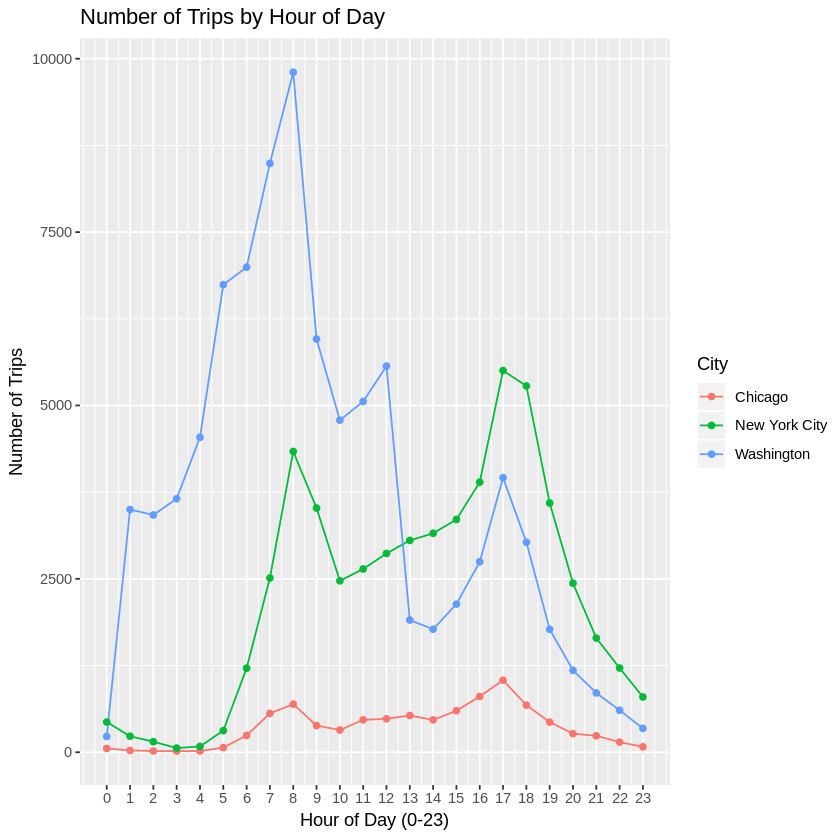
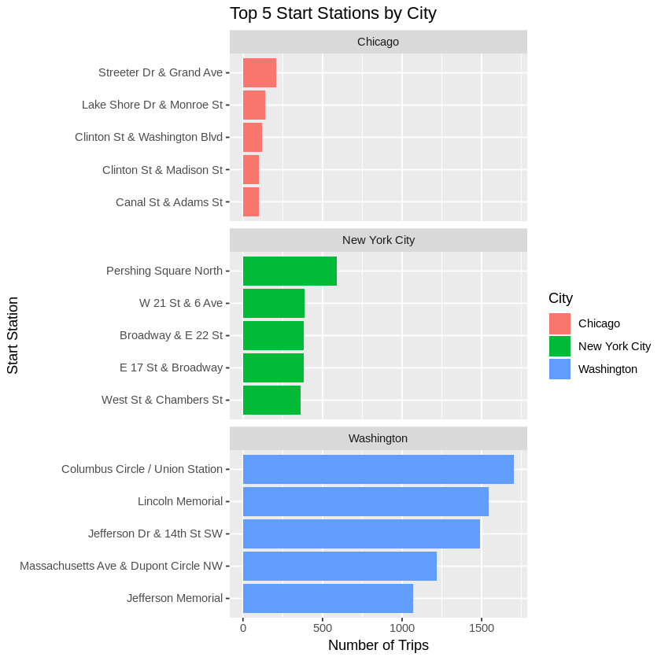
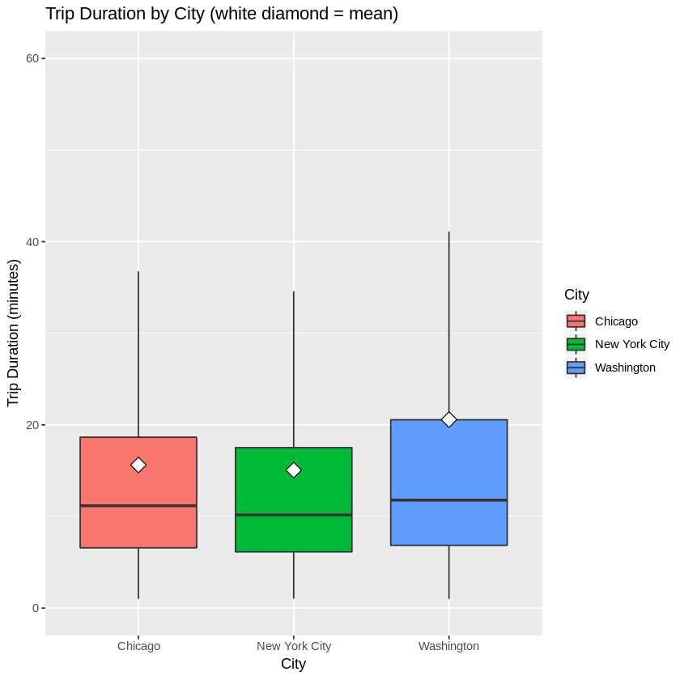
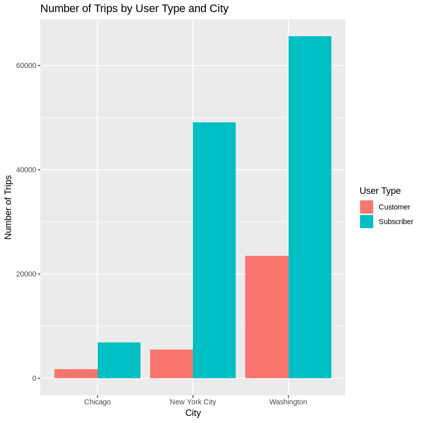
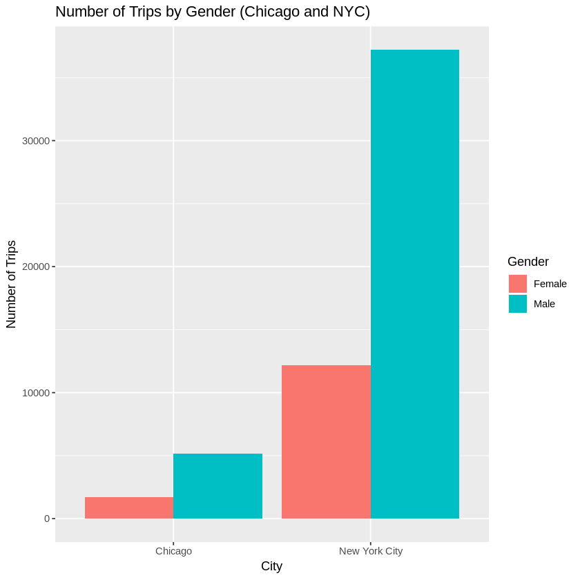

### Explore Bike Share Data

For this project, your goal is to ask and answer three questions about the available bikeshare data from Washington, Chicago, and New York.  This notebook can be submitted directly through the workspace when you are confident in your results.

You will be graded against the project [Rubric](https://review.udacity.com/#!/rubrics/2508/view) by a mentor after you have submitted.  To get you started, you can use the template below, but feel free to be creative in your solutions!


```R
library(ggplot2)

ny = read.csv('new_york_city.csv')
wash = read.csv('washington.csv')
chi = read.csv('chicago.csv')
```


```R
head(ny)
```


<table>
<thead><tr><th scope=col>X</th><th scope=col>Start.Time</th><th scope=col>End.Time</th><th scope=col>Trip.Duration</th><th scope=col>Start.Station</th><th scope=col>End.Station</th><th scope=col>User.Type</th><th scope=col>Gender</th><th scope=col>Birth.Year</th></tr></thead>
<tbody>
	<tr><td>5688089                                       </td><td>2017-06-11 14:55:05                           </td><td>2017-06-11 15:08:21                           </td><td> 795                                          </td><td>Suffolk St &amp; Stanton St                   </td><td>W Broadway &amp; Spring St                    </td><td>Subscriber                                    </td><td><span style=white-space:pre-wrap>Male  </span></td><td>1998                                          </td></tr>
	<tr><td>4096714                                                           </td><td>2017-05-11 15:30:11                                               </td><td>2017-05-11 15:41:43                                               </td><td> 692                                                              </td><td>Lexington Ave &amp; E 63 St                                       </td><td><span style=white-space:pre-wrap>1 Ave &amp; E 78 St       </span></td><td>Subscriber                                                        </td><td><span style=white-space:pre-wrap>Male  </span>                    </td><td>1981                                                              </td></tr>
	<tr><td>2173887                                                            </td><td>2017-03-29 13:26:26                                                </td><td>2017-03-29 13:48:31                                                </td><td>1325                                                               </td><td><span style=white-space:pre-wrap>1 Pl &amp; Clinton St      </span></td><td><span style=white-space:pre-wrap>Henry St &amp; Degraw St  </span> </td><td>Subscriber                                                         </td><td><span style=white-space:pre-wrap>Male  </span>                     </td><td>1987                                                               </td></tr>
	<tr><td>3945638                                                            </td><td>2017-05-08 19:47:18                                                </td><td>2017-05-08 19:59:01                                                </td><td> 703                                                               </td><td><span style=white-space:pre-wrap>Barrow St &amp; Hudson St  </span></td><td><span style=white-space:pre-wrap>W 20 St &amp; 8 Ave       </span> </td><td>Subscriber                                                         </td><td>Female                                                             </td><td>1986                                                               </td></tr>
	<tr><td>6208972                                                            </td><td>2017-06-21 07:49:16                                                </td><td>2017-06-21 07:54:46                                                </td><td> 329                                                               </td><td><span style=white-space:pre-wrap>1 Ave &amp; E 44 St        </span></td><td><span style=white-space:pre-wrap>E 53 St &amp; 3 Ave       </span> </td><td>Subscriber                                                         </td><td><span style=white-space:pre-wrap>Male  </span>                     </td><td>1992                                                               </td></tr>
	<tr><td>1285652                                                            </td><td>2017-02-22 18:55:24                                                </td><td>2017-02-22 19:12:03                                                </td><td> 998                                                               </td><td><span style=white-space:pre-wrap>State St &amp; Smith St    </span></td><td><span style=white-space:pre-wrap>Bond St &amp; Fulton St   </span> </td><td>Subscriber                                                         </td><td><span style=white-space:pre-wrap>Male  </span>                     </td><td>1986                                                               </td></tr>
</tbody>
</table>


```R
head(wash)
```


<table>
<thead><tr><th scope=col>X</th><th scope=col>Start.Time</th><th scope=col>End.Time</th><th scope=col>Trip.Duration</th><th scope=col>Start.Station</th><th scope=col>End.Station</th><th scope=col>User.Type</th></tr></thead>
<tbody>
	<tr><td>1621326                                                                                        </td><td>2017-06-21 08:36:34                                                                            </td><td>2017-06-21 08:44:43                                                                            </td><td> 489.066                                                                                       </td><td><span style=white-space:pre-wrap>14th &amp; Belmont St NW                       </span>        </td><td><span style=white-space:pre-wrap>15th &amp; K St NW                                     </span></td><td>Subscriber                                                                                     </td></tr>
	<tr><td> 482740                                                                                        </td><td>2017-03-11 10:40:00                                                                            </td><td>2017-03-11 10:46:00                                                                            </td><td> 402.549                                                                                       </td><td><span style=white-space:pre-wrap>Yuma St &amp; Tenley Circle NW                 </span>        </td><td><span style=white-space:pre-wrap>Connecticut Ave &amp; Yuma St NW                       </span></td><td>Subscriber                                                                                     </td></tr>
	<tr><td>1330037                                                                                        </td><td>2017-05-30 01:02:59                                                                            </td><td>2017-05-30 01:13:37                                                                            </td><td> 637.251                                                                                       </td><td><span style=white-space:pre-wrap>17th St &amp; Massachusetts Ave NW             </span>        </td><td><span style=white-space:pre-wrap>5th &amp; K St NW                                      </span></td><td>Subscriber                                                                                     </td></tr>
	<tr><td> 665458                                                                                        </td><td>2017-04-02 07:48:35                                                                            </td><td>2017-04-02 08:19:03                                                                            </td><td>1827.341                                                                                       </td><td><span style=white-space:pre-wrap>Constitution Ave &amp; 2nd St NW/DOL           </span>        </td><td><span style=white-space:pre-wrap>M St &amp; Pennsylvania Ave NW                         </span></td><td><span style=white-space:pre-wrap>Customer  </span>                                             </td></tr>
	<tr><td>1481135                                                                                        </td><td>2017-06-10 08:36:28                                                                            </td><td>2017-06-10 09:02:17                                                                            </td><td>1549.427                                                                                       </td><td>Henry Bacon Dr &amp; Lincoln Memorial Circle NW                                                </td><td><span style=white-space:pre-wrap>Maine Ave &amp; 7th St SW                              </span></td><td>Subscriber                                                                                     </td></tr>
	<tr><td>1148202                                                                                </td><td>2017-05-14 07:18:18                                                                    </td><td>2017-05-14 07:24:56                                                                    </td><td> 398.000                                                                               </td><td><span style=white-space:pre-wrap>1st &amp; K St SE                              </span></td><td>Eastern Market Metro / Pennsylvania Ave &amp; 7th St SE                                </td><td>Subscriber                                                                             </td></tr>
</tbody>
</table>


```R
head(chi)
```


<table>
<thead><tr><th scope=col>X</th><th scope=col>Start.Time</th><th scope=col>End.Time</th><th scope=col>Trip.Duration</th><th scope=col>Start.Station</th><th scope=col>End.Station</th><th scope=col>User.Type</th><th scope=col>Gender</th><th scope=col>Birth.Year</th></tr></thead>
<tbody>
	<tr><td>1423854                                                                  </td><td>2017-06-23 15:09:32                                                      </td><td>2017-06-23 15:14:53                                                      </td><td> 321                                                                     </td><td><span style=white-space:pre-wrap>Wood St &amp; Hubbard St         </span></td><td><span style=white-space:pre-wrap>Damen Ave &amp; Chicago Ave     </span> </td><td>Subscriber                                                               </td><td><span style=white-space:pre-wrap>Male  </span>                           </td><td>1992                                                                     </td></tr>
	<tr><td> 955915                                                              </td><td>2017-05-25 18:19:03                                                  </td><td>2017-05-25 18:45:53                                                  </td><td>1610                                                                 </td><td><span style=white-space:pre-wrap>Theater on the Lake          </span></td><td>Sheffield Ave &amp; Waveland Ave                                     </td><td>Subscriber                                                           </td><td>Female                                                               </td><td>1992                                                                 </td></tr>
	<tr><td><span style=white-space:pre-wrap>   9031</span>                          </td><td>2017-01-04 08:27:49                                                      </td><td>2017-01-04 08:34:45                                                      </td><td> 416                                                                     </td><td><span style=white-space:pre-wrap>May St &amp; Taylor St           </span></td><td><span style=white-space:pre-wrap>Wood St &amp; Taylor St         </span> </td><td>Subscriber                                                               </td><td><span style=white-space:pre-wrap>Male  </span>                           </td><td>1981                                                                     </td></tr>
	<tr><td> 304487                                       </td><td>2017-03-06 13:49:38                           </td><td>2017-03-06 13:55:28                           </td><td> 350                                          </td><td>Christiana Ave &amp; Lawrence Ave             </td><td>St. Louis Ave &amp; Balmoral Ave              </td><td>Subscriber                                    </td><td><span style=white-space:pre-wrap>Male  </span></td><td>1986                                          </td></tr>
	<tr><td><span style=white-space:pre-wrap>  45207</span>                          </td><td>2017-01-17 14:53:07                                                      </td><td>2017-01-17 15:02:01                                                      </td><td> 534                                                                     </td><td><span style=white-space:pre-wrap>Clark St &amp; Randolph St       </span></td><td>Desplaines St &amp; Jackson Blvd                                         </td><td>Subscriber                                                               </td><td><span style=white-space:pre-wrap>Male  </span>                           </td><td>1975                                                                     </td></tr>
	<tr><td>1473887                                                                 </td><td>2017-06-26 09:01:20                                                     </td><td>2017-06-26 09:11:06                                                     </td><td> 586                                                                    </td><td>Clinton St &amp; Washington Blvd                                        </td><td><span style=white-space:pre-wrap>Canal St &amp; Taylor St        </span></td><td>Subscriber                                                              </td><td><span style=white-space:pre-wrap>Male  </span>                          </td><td>1990                                                                    </td></tr>
</tbody>
</table>


```R
cities = list("Chicago" = chi, "New York City" = ny, "Washington" = wash)

# Returns the most frequent non-missing, non-blank value
most_common = function(x) {
  x = x[!is.na(x) & x != ""]
  names(which.max(table(x)))
}

# Removes extra spaces from the text columns that have them
clean_text = function(df) {
  for (col in c("Start.Station", "End.Station", "User.Type", "Gender")) {
    if (col %in% names(df)) {
      df[[col]] = trimws(as.character(df[[col]]))
    }
  }
  df
}

# Adds Month, Day and Hour columns based on Start.Time
add_time_columns = function(df) {
  start = as.POSIXct(df$Start.Time, format = "%Y-%m-%d %H:%M:%S", tz = "UTC")
  df$Month = format(start, "%B")
  df$Day = format(start, "%A")
  df$Hour = as.integer(format(start, "%H"))
  df
}

cities = lapply(cities, clean_text)
cities = lapply(cities, add_time_columns)
```

### Question 1

**Question 1: What are the most common month, day and hour of travel in each city, and how do trips change over the day?**


```R
# Most common month, day of week and hour for each city
for (city in names(cities)) {
  df = cities[[city]]
  cat("\n---", city, "---\n")
  cat("Most common month:      ", most_common(df$Month), "\n")
  cat("Most common day of week:", most_common(df$Day), "\n")
  cat("Most common hour of day:", most_common(df$Hour), "\n")
}

# Plot: trips by hour of day, to see when each city is busiest
hourly = do.call(rbind, lapply(names(cities), function(city) {
  counts = as.data.frame(table(Hour = cities[[city]]$Hour))
  counts$City = city
  counts
}))
hourly$Hour = as.integer(as.character(hourly$Hour))

p1 = ggplot(hourly, aes(x = Hour, y = Freq, color = City)) +
  geom_line() +
  geom_point() +
  scale_x_continuous(breaks = 0:23) +
  labs(title = "Number of Trips by Hour of Day",
       x = "Hour of Day (0-23)",
       y = "Number of Trips",
       color = "City")
print(p1)
```

    
    --- Chicago ---
    Most common month:       June 
    Most common day of week: Monday 
    Most common hour of day: 17 
    
    --- New York City ---
    Most common month:       June 
    Most common day of week: Wednesday 
    Most common hour of day: 17 
    
    --- Washington ---
    Most common month:       June 
    Most common day of week: Wednesday 
    Most common hour of day: 8 





**Observations (Question 1):**

- **Most common month:** June in all three cities, so bike use is highest as the weather warms up.
- **Most common day of week:** Monday in Chicago, and Wednesday in both New York City and Washington.
- **Most common hour:** 5 PM (hour 17) in Chicago and New York City, and 8 AM (hour 8) in Washington.
- **Hourly pattern:** New York City has two clear rush-hour peaks, one around 8 AM and a bigger one around 5 PM. Washington has the same two peaks, but its morning peak is much taller, at roughly 10,000 trips. Chicago's line is much flatter, with a small rise around 5 PM. The two peaks suggest many riders use the bikes to commute to and from work.
- **Note:** The three files are different sizes, so the number of trips should not be compared between cities. The shape of each line is the useful comparison.

### Question 2

**Question 2: What are the most common start station, end station and trip in each city, and which five start stations are busiest?**


```R
# Most common start station, end station and trip
for (city in names(cities)) {
  df = cities[[city]]
  trip = paste(df$Start.Station, "to", df$End.Station)
  cat("\n---", city, "---\n")
  cat("Most common start station:", most_common(df$Start.Station), "\n")
  cat("Most common end station:  ", most_common(df$End.Station), "\n")
  cat("Most common trip:         ", most_common(trip), "\n")
}

# Plot: top 5 start stations per city
top_stations = function(df, city, n = 5) {
  stations = df$Start.Station[!is.na(df$Start.Station) & df$Start.Station != ""]
  top = head(sort(table(stations), decreasing = TRUE), n)
  data.frame(Station = names(top), Trips = as.integer(top), City = city)
}

top_start = do.call(rbind, lapply(names(cities), function(city) {
  top_stations(cities[[city]], city)
}))

p2 = ggplot(top_start, aes(x = reorder(Station, Trips), y = Trips, fill = City)) +
  geom_col() +
  coord_flip() +
  facet_wrap(~ City, ncol = 1, scales = "free_y") +
  labs(title = "Top 5 Start Stations by City",
       x = "Start Station",
       y = "Number of Trips",
       fill = "City")
print(p2)
```

    
    --- Chicago ---
    Most common start station: Streeter Dr & Grand Ave 
    Most common end station:   Streeter Dr & Grand Ave 
    Most common trip:          Lake Shore Dr & Monroe St to Streeter Dr & Grand Ave 
    
    --- New York City ---
    Most common start station: Pershing Square North 
    Most common end station:   Pershing Square North 
    Most common trip:          E 7 St & Avenue A to Cooper Square & E 7 St 
    
    --- Washington ---
    Most common start station: Columbus Circle / Union Station 
    Most common end station:   Columbus Circle / Union Station 
    Most common trip:          Jefferson Dr & 14th St SW to Jefferson Dr & 14th St SW 





**Observations (Question 2):**

- **Most common start station:** Streeter Dr & Grand Ave in Chicago, Pershing Square North in New York City, and Columbus Circle / Union Station in Washington.
- **Most common end station:** The same station as the most common start station in all three cities: Streeter Dr & Grand Ave (Chicago), Pershing Square North (New York City) and Columbus Circle / Union Station (Washington).
- **Most common trip:** Lake Shore Dr & Monroe St to Streeter Dr & Grand Ave in Chicago, E 7 St & Avenue A to Cooper Square & E 7 St in New York City, and Jefferson Dr & 14th St SW to Jefferson Dr & 14th St SW in Washington.
- **Top 5 chart:** In Washington, the busiest start stations have far more trips than in the other cities, with the top station at roughly 1,700 trips. In New York City, Pershing Square North stands out at about 580 trips, while the next four stations are close together at roughly 350 to 400 trips each. In Chicago, the five stations have fairly similar, smaller counts. This is partly because the chart uses the same x-axis for every city and Chicago's file has fewer trips.
- **Insight:** The busiest stations are often at major landmarks and transit hubs, such as Union Station in Washington, Pershing Square North in New York City (near Grand Central) and Streeter Dr & Grand Ave in Chicago (near Navy Pier). Washington's most common trip starts and ends at the same station, which suggests many riders take round trips for leisure or sightseeing, for example around the National Mall.

### Question 3

**Question 3: What are the total and average trip durations in each city, and how do the trip-duration distributions compare?**


```R
# Duration statistics per city (seconds converted to hours and minutes)
duration_summary = do.call(rbind, lapply(names(cities), function(city) {
  d = cities[[city]]$Trip.Duration
  data.frame(City = city,
             Trips = length(d),
             Total_Hours = round(sum(d, na.rm = TRUE) / 3600, 1),
             Mean_Minutes = round(mean(d, na.rm = TRUE) / 60, 2),
             Median_Minutes = round(median(d, na.rm = TRUE) / 60, 2))
}))
print(duration_summary)

# Combine all cities into one table (also needed for Question 4)
all_trips = do.call(rbind, lapply(names(cities), function(city) {
  df = cities[[city]]
  data.frame(City = city,
             Duration_Minutes = df$Trip.Duration / 60,
             User.Type = df$User.Type)
}))

# Plot: boxplot of duration by city (white diamond = mean), zoomed to 0-60 minutes
p3 = ggplot(all_trips, aes(x = City, y = Duration_Minutes, fill = City)) +
  geom_boxplot(outlier.shape = NA) +
  geom_point(data = duration_summary, aes(x = City, y = Mean_Minutes),
             shape = 23, size = 4, fill = "white", inherit.aes = FALSE) +
  coord_cartesian(ylim = c(0, 60)) +
  labs(title = "Trip Duration by City (white diamond = mean)",
       x = "City",
       y = "Trip Duration (minutes)",
       fill = "City")
print(p3)
```

               City Trips Total_Hours Mean_Minutes Median_Minutes
    1       Chicago  8630      2246.6        15.62          11.17
    2 New York City 54770     13747.2        15.06          10.17
    3    Washington 89051     30523.2        20.57          11.78


    Warning message:
    “Removed 2 rows containing non-finite values (stat_boxplot).”





**Observations (Question 3):**

- **Total travel time:** Washington has the highest total at about 30,523 hours, followed by New York City at about 13,747 hours and Chicago at about 2,247 hours. These totals mostly reflect how many trips are in each file (Washington 89,051, New York City 54,770, Chicago 8,630), so they should not be compared directly between cities.
- **Average trip duration:** Washington has the longest average trip at about 20.57 minutes. Chicago is about 15.62 minutes and New York City is about 15.06 minutes.
- **Median trip duration:** The medians are lower and much closer together: about 11.17 minutes in Chicago, 10.17 in New York City and 11.78 in Washington. A typical trip in all three cities is roughly 10 to 12 minutes.
- **Mean vs. median:** In every city the mean is higher than the median, so a small number of very long trips pull the average up. The gap is largest in Washington (about 8.8 minutes), compared with about 4.5 minutes in Chicago and 4.9 in New York City. This is why the median is a better measure of a typical trip.
- **Boxplot:** The middle 50% of trips last roughly 6 to 20 minutes in all three cities. Washington's box and upper whisker are the tallest, which means its trip durations vary more. The white diamonds (means) sit above the median lines in all three boxes, which matches the mean-versus-median result above. The y-axis is zoomed to 0-60 minutes so the boxes are readable, and the summary table uses all trips.

### Question 4

**Question 4: How many Subscribers and Customers are there in each city, what is the gender split, and what are the earliest, most recent and most common birth years?**


```R
# User type counts for each city
for (city in names(cities)) {
  cat("\n---", city, "---\n")
  print(table(cities[[city]]$User.Type))
}

# Gender and birth year (Chicago and New York City only)
for (city in c("Chicago", "New York City")) {
  df = cities[[city]]
  gender = df$Gender[!is.na(df$Gender) & df$Gender != ""]
  birth = df$Birth.Year[!is.na(df$Birth.Year)]
  cat("\n---", city, "---\n")
  print(table(gender))
  cat("Earliest birth year:   ", min(birth), "\n")
  cat("Most recent birth year:", max(birth), "\n")
  cat("Most common birth year:", most_common(birth), "\n")
}
cat("\nWashington has no gender or birth year data.\n")
```

    
    --- Chicago ---
    
                 Customer Subscriber 
             1       1746       6883 
    
    --- New York City ---
    
                 Customer Subscriber 
           119       5558      49093 
    
    --- Washington ---
    
                 Customer Subscriber 
             1      23450      65600 
    
    --- Chicago ---
    gender
    Female   Male 
      1723   5159 
    Earliest birth year:    1899 
    Most recent birth year: 2002 
    Most common birth year: 1989 
    
    --- New York City ---
    gender
    Female   Male 
     12159  37201 
    Earliest birth year:    1885 
    Most recent birth year: 2001 
    Most common birth year: 1989 
    
    Washington has no gender or birth year data.


```R
# Plot: user types by city
valid_users = all_trips[!is.na(all_trips$User.Type) & all_trips$User.Type != "", ]

p4 = ggplot(valid_users, aes(x = City, fill = User.Type)) +
  geom_bar(position = "dodge") +
  labs(title = "Number of Trips by User Type and City",
       x = "City",
       y = "Number of Trips",
       fill = "User Type")
print(p4)

# Plot: gender by city (Chicago and NYC only)
gender_counts = do.call(rbind, lapply(c("Chicago", "New York City"), function(city) {
  g = cities[[city]]$Gender
  g = g[!is.na(g) & g != ""]
  counts = as.data.frame(table(Gender = g))
  counts$City = city
  counts
}))

p5 = ggplot(gender_counts, aes(x = City, y = Freq, fill = Gender)) +
  geom_col(position = "dodge") +
  labs(title = "Number of Trips by Gender (Chicago and NYC)",
       x = "City",
       y = "Number of Trips",
       fill = "Gender")
print(p5)
```








**Observations (Question 4):**

- **User types:** Subscribers are the large majority in every city. Chicago has 6,883 Subscribers and 1,746 Customers (about 80% Subscribers). New York City has 49,093 Subscribers and 5,558 Customers (about 90%). Washington has 65,600 Subscribers and 23,450 Customers (about 74%). The bar chart shows the same pattern. A very small number of trips (1 in Chicago, 119 in New York City and 1 in Washington) have a blank user type, so they are left out of the chart.
- **Gender (Chicago and New York City only):** Chicago has 5,159 male and 1,723 female riders. New York City has 37,201 male and 12,159 female riders. In both cities about 75% of riders with a recorded gender are male. Gender is missing for many trips (about 1,750 in Chicago and 5,400 in New York City), so these figures only describe riders who reported their gender.
- **Birth year (Chicago and New York City only):** The earliest birth year is 1899 in Chicago and 1885 in New York City. These are probably data-entry errors, since they would make the riders well over 100 years old. The most recent birth year is 2002 in Chicago and 2001 in New York City. The most common birth year is 1989 in both cities, so the typical rider is in their late 20s to 30s.
- **Washington:** This file has no gender or birth year columns, so those statistics could not be computed.


## Finishing Up

> Congratulations!  You have reached the end of the Explore Bikeshare Data Project. You should be very proud of all you have accomplished!

> **Tip**: Once you are satisfied with your work here, check over your report to make sure that it is satisfies all the areas of the [rubric](https://review.udacity.com/#!/rubrics/2508/view). 


## Directions to Submit

> Before you submit your project, you need to create a .html or .pdf version of this notebook in the workspace here. To do that, run the code cell below. If it worked correctly, you should get a return code of 0, and you should see the generated .html file in the workspace directory (click on the orange Jupyter icon in the upper left).

> Alternatively, you can download this report as .html via the **File** > **Download as** submenu, and then manually upload it into the workspace directory by clicking on the orange Jupyter icon in the upper left, then using the Upload button.

> Once you've done this, you can submit your project by clicking on the "Submit Project" button in the lower right here. This will create and submit a zip file with this .ipynb doc and the .html or .pdf version you created. Congratulations!


```R
system('python -m nbconvert Explore_bikeshare_data.ipynb')
```
